# MBook – Online Bookstore

MBook is an online bookstore that I built to improve my skills in backend and full-stack development. Customers can find printed books and ebooks, place orders, make test payments, and download purchased ebooks. I also built an admin dashboard to manage books, orders, shipments, and users.

I used **Spring Boot** for the backend, **React** for the frontend, and **PostgreSQL** for the database. The backend runs on **Microsoft Azure**, and the frontend is hosted on **Vercel**.

> **Demo project:** Payments use **PayHere Sandbox**. The website does not accept real payments.

**Live website:** [shop.muchlogic.com](https://shop.muchlogic.com/)
**Backend API:** [books.muchlogic.com](https://books.muchlogic.com/)
**GitHub:** [bookstore_project](https://github.com/thisaraCPrasanga/bookstore_project)

## Features

### Customer

- Browse printed books and ebooks, with search by title, author, or genre.
- View book details, price, cover image, and stock.
- Register, log in, and manage a shopping cart.
- Place orders and pay through PayHere Sandbox.
- View order history and payment status.
- Download purchased ebooks after a successful payment.
- Use the website on desktop, tablet, or mobile.

### Admin

- View sales, order statistics, and low-stock books.
- Add, update, and hide books.
- View orders and cancel eligible unpaid orders.
- Manage shipments and tracking details.
- View users and manage their roles.

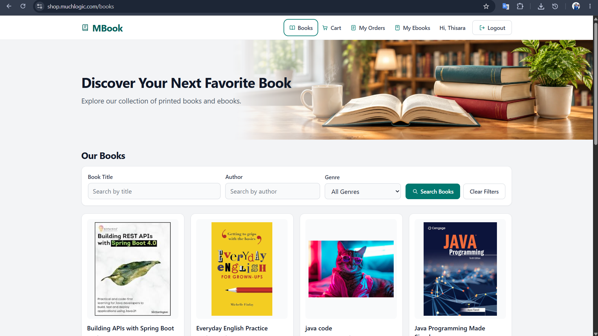
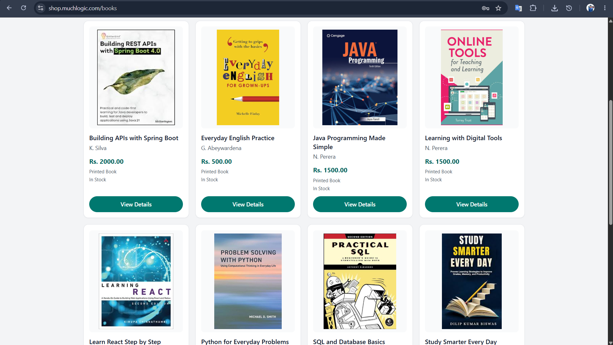
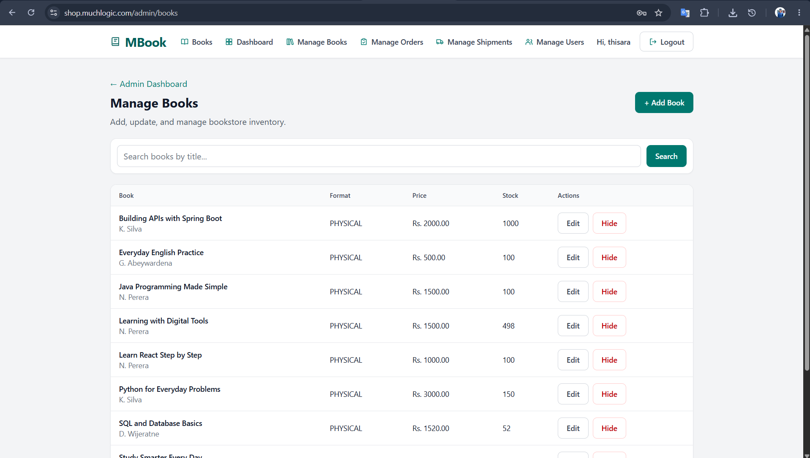
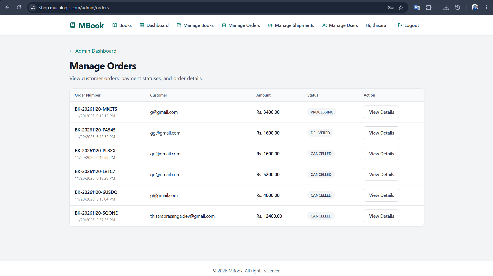

## Technology Stack

| Area | Technologies |
| --- | --- |
| Backend | Java 17, Spring Boot 4.1.1, Spring Web MVC |
| Security | Spring Security, JWT, HttpOnly cookies, CSRF, BCrypt |
| Database | PostgreSQL 16, Spring Data JPA, Hibernate, Flyway |
| Frontend | React 19, JavaScript, Vite 8, Tailwind CSS 4 |
| Frontend libraries | Axios, React Router |
| Payment gateway | PayHere Sandbox |
| API documentation | Springdoc OpenAPI / Swagger UI (development) |
| Testing | Maven tests, ESLint, Vite production build |
| DevOps | Git, GitHub Actions, Docker, Docker Compose, GHCR |
| Hosting | Microsoft Azure VM, Ubuntu, Caddy, Vercel |

## System Architecture

I used a **monolithic backend**. All backend features run inside one Spring Boot application. I organized the code into separate feature packages so that it is easier to understand and maintain.


The main request flow is:

1. A visitor opens the React website on Vercel.
2. The frontend sends a request to `/api/v1/*`.
3. A Vercel rewrite forwards the request to `books.muchlogic.com`.
4. Caddy provides HTTPS and forwards the request to Spring Boot on the Azure VM.
5. Spring Boot processes the request and uses JPA/Hibernate to access PostgreSQL.
6. For a payment, PayHere sends a separate notification to the backend.

### Main backend modules

| Package | Responsibility |
| --- | --- |
| `catalog` | Books, search, stock, and book management |
| `cart` | Shopping cart operations |
| `order` | Orders and their status |
| `payment` | PayHere checkout and payment verification |
| `fulfilment` | Shipments and ebook downloads |
| `user` | Accounts and user roles |
| `security` | JWT, cookies, CSRF, and access rules |
| `shared` | Common errors and shared code |

**Flyway** manages database changes using versioned SQL migrations (V1–V6).

## Authentication and Security

I used **Spring Security** to protect the APIs. The application uses stateless authentication with **JWT**.

- **Login:** The backend checks the password with BCrypt and creates a signed JWT.
- **HttpOnly cookie:** The JWT is stored in the `__Host-access_token` cookie, not in browser `localStorage`. The cookie uses `HttpOnly`, `Secure`, `SameSite=Lax`, and `Path=/`.
- **CSRF:** The browser receives an `XSRF-TOKEN` cookie. Axios sends it through the `X-XSRF-TOKEN` header for protected requests.
- **Authorization:** Customers and admins have different permissions. Spring Security checks these permissions on the backend.
- **Validation:** The backend checks incoming data and returns errors for invalid requests.
- **Book updates:** Version checking helps prevent conflicting updates.

The PayHere notification endpoint does not use the browser CSRF token because the request comes from PayHere. Instead, the backend verifies the payment notification signature.

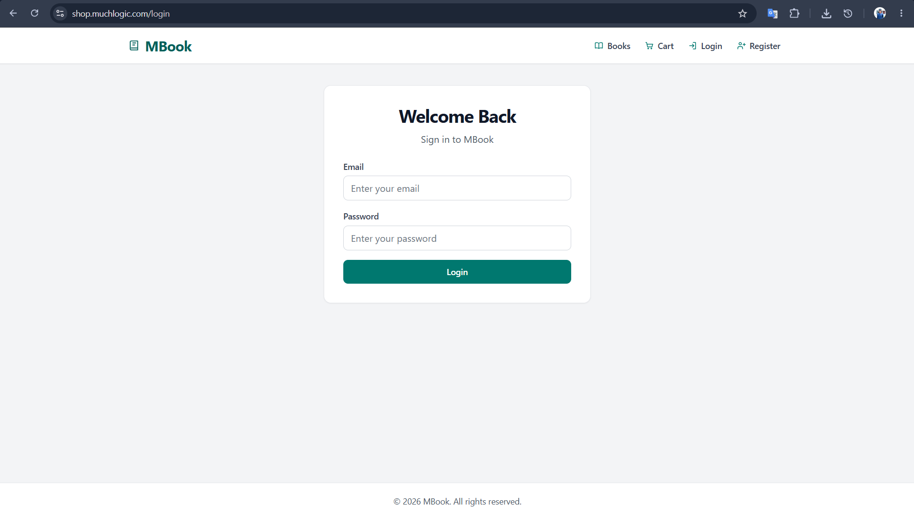

## Main REST APIs

The base API path is **`/api/v1`**.

| Method | Endpoint | Purpose |
| --- | --- | --- |
| `GET` | `/books` | List and search books |
| `GET` | `/books/{id}` | View a book |
| `POST`, `PUT`, `DELETE` | `/books`, `/books/{id}` | Admin book management |
| `POST` | `/users/register`, `/users/login`, `/users/logout` | Account actions |
| `GET` | `/users/me`, `/auth/csrf` | Current user and CSRF token |
| `GET`, `POST`, `PATCH`, `DELETE` | `/cart`, `/cart/items` | Shopping cart operations |
| `POST` | `/orders` | Place an order |
| `GET` | `/orders/my`, `/orders/{id}` | Order history and details |
| `GET`, `PATCH` | `/orders`, `/orders/{id}/status` | Admin order management |
| `POST` | `/payments/{orderId}/checkout` | Prepare PayHere checkout |
| `POST` | `/payments/payhere/notify` | Receive PayHere payment notification |
| `GET` | `/downloads/my`, `/downloads/{token}` | Purchased ebook downloads |
| `GET` | `/admin/stats` | Admin dashboard statistics |
| `GET`, `PATCH` | `/shipments`, `/shipments/{id}` | Shipment management |
| `GET`, `PATCH` | `/users`, `/users/{id}/role` | Admin user management |

Public book endpoints do not require login. Cart, order, download, and admin operations have role-based access rules. Swagger UI is available during development and disabled in the production profile.

## PayHere Sandbox Payment

I used PayHere Sandbox to test the payment process without real money.

```text
Customer places an order
          ↓
Order status: PENDING_PAYMENT
          ↓
Backend creates checkout fields and a payment hash
          ↓
Customer completes the payment on PayHere Sandbox
          ↓
PayHere sends a notification to the backend
          ↓
Backend checks the signature, amount, and currency
          ↓
Successful payment is recorded
          ↓
Printed book → Shipment created
Ebook        → Download access granted
```

The customer returns to the frontend after checkout, but **the return page does not confirm payment**. The backend updates the order after validating the PayHere server notification (`md5sig`).

The deployed demo uses `shop.muchlogic.com` for payment return/cancel pages and `books.muchlogic.com` for PayHere notifications. Merchant credentials are kept in the backend environment, not in frontend code.

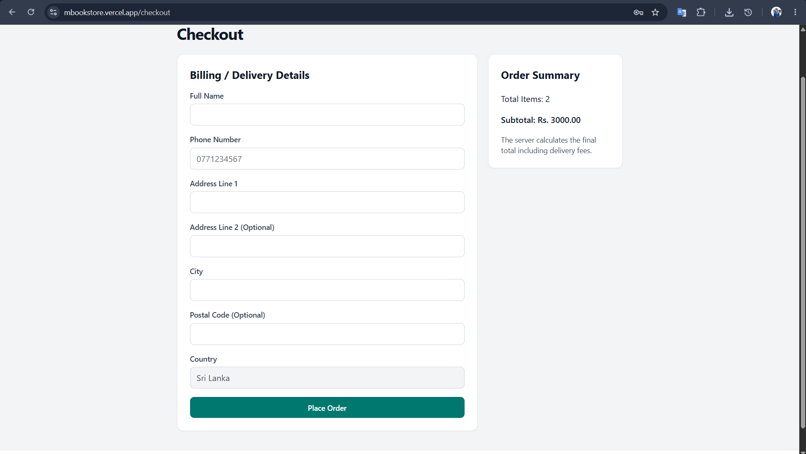
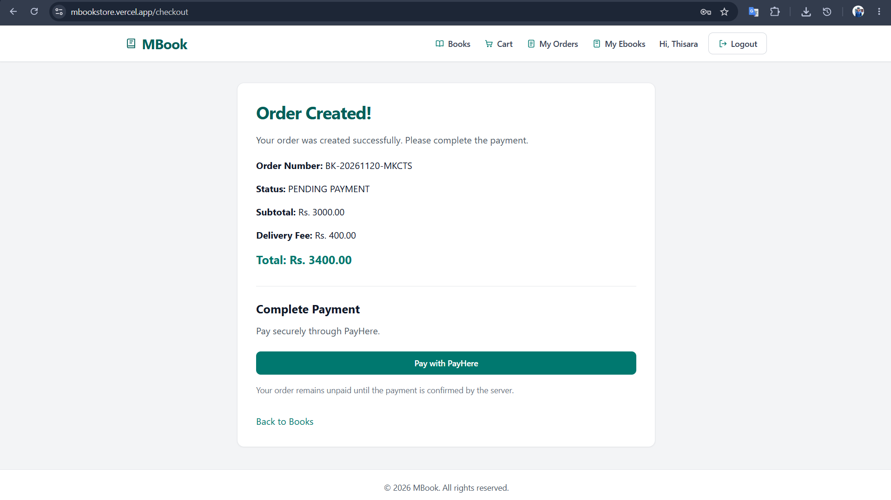
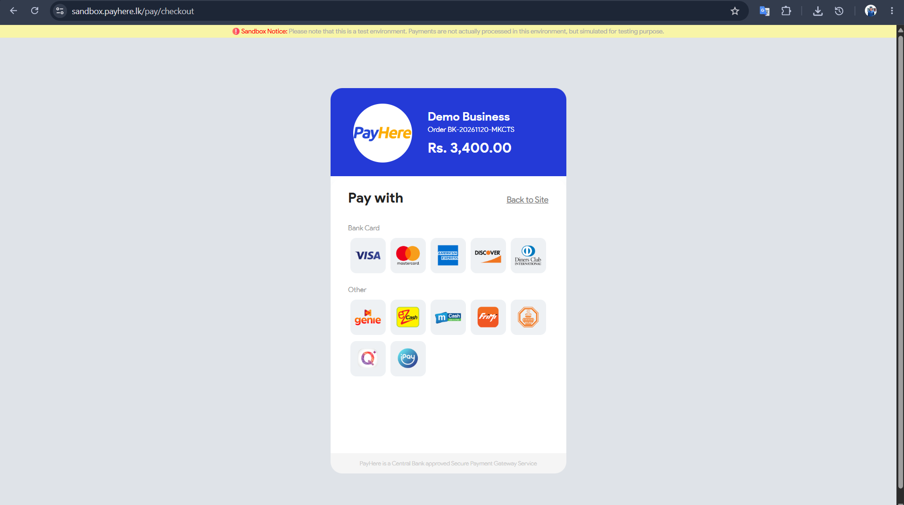
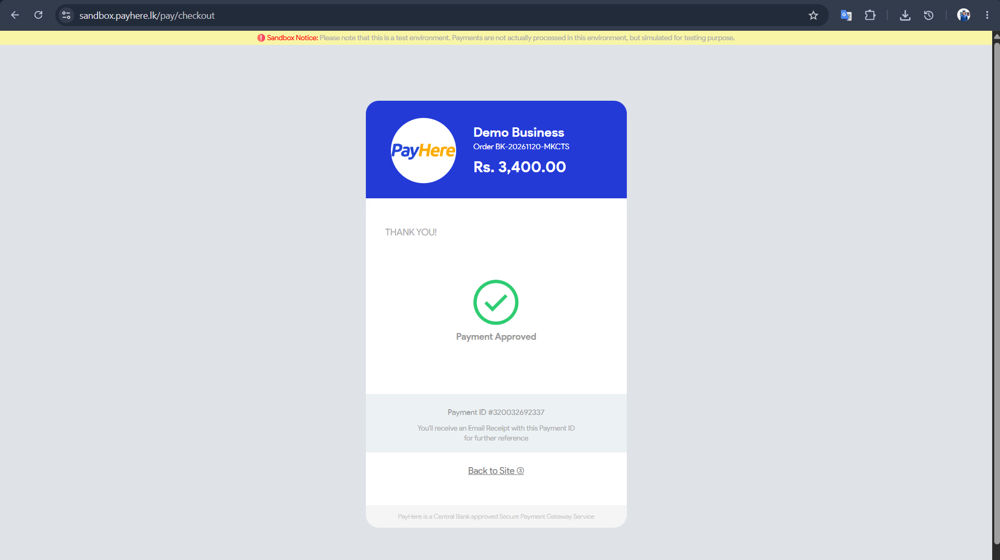
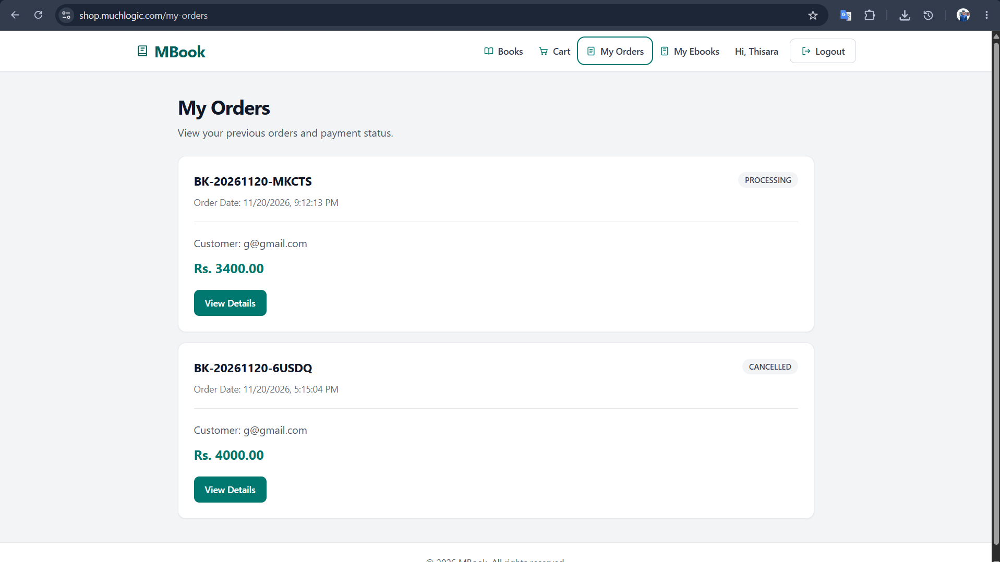

## Hosting and CI/CD

### Azure backend

The backend runs on an Ubuntu VM in **Microsoft Azure**. Docker Compose runs the Spring Boot application and **PostgreSQL 16** in separate containers. PostgreSQL data uses a Docker volume, and ebook files use a mounted directory. **Caddy** handles HTTPS traffic for `books.muchlogic.com`.

### Vercel frontend

The React frontend is hosted on **Vercel** at `shop.muchlogic.com`. The project builds from the `frontend-js` directory. Its `vercel.json` file forwards `/api/*` requests to the Azure backend and supports React page routing.

### GitHub Actions

I configured three workflows:

1. **Backend CI:** Runs Maven verification with PostgreSQL.
2. **Frontend CI:** Runs npm installation, ESLint, and the Vite build.
3. **Docker Publish:** Builds and publishes the backend image to GitHub Container Registry (GHCR) after successful qualifying backend CI runs on `main`.

The Azure container is updated separately after a new image is published.

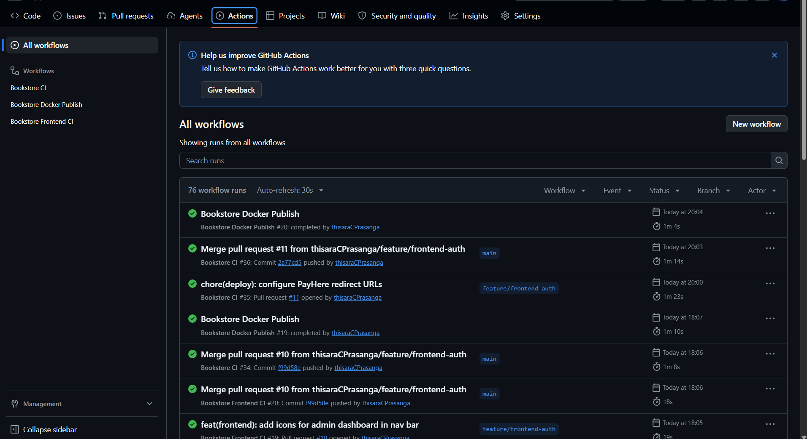

## Project Structure

```text
bookstore_project/
├── .github/workflows/        # Backend CI, frontend CI, Docker publish
├── frontend-js/              # React frontend
│   ├── src/pages/            # Customer and admin pages
│   ├── src/services/api.js   # Axios client
│   └── vercel.json           # Vercel rewrites
├── src/main/java/            # Spring Boot backend
├── src/main/resources/db/    # Flyway migrations
├── src/test/                 # Backend tests
├── docs/images/             # Architecture diagram
├── docs/screenshots/        # Application screenshots
├── Dockerfile
├── docker-compose.yaml
├── docker-compose.prod.yaml
└── pom.xml
```

## Project Status

The customer and admin features, responsive frontend, Azure and Vercel deployments, and PayHere Sandbox checkout have been implemented and tested. This is a **portfolio/demo project**. Real payments would require a separate PayHere live merchant configuration and production checks.


I built this project to learn more about backend development, security, databases, payment integration, Docker, CI/CD, and cloud hosting.
